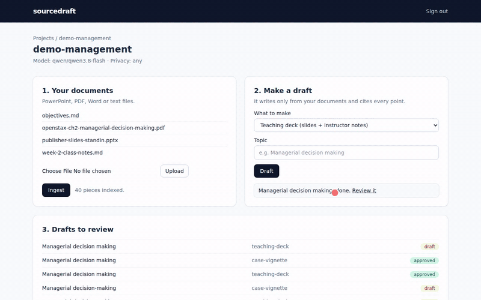
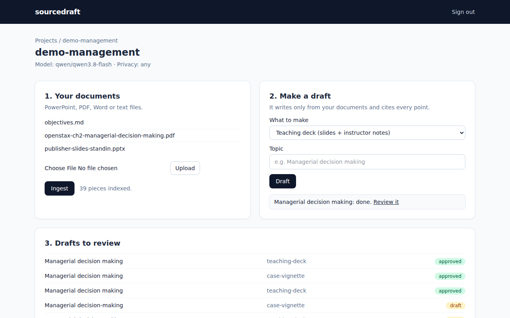
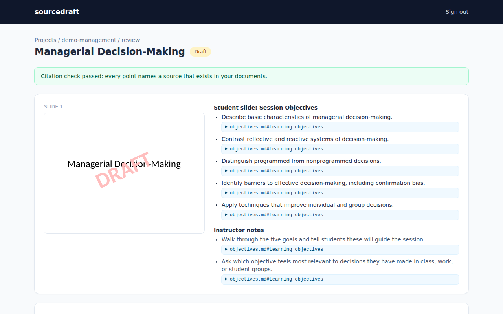
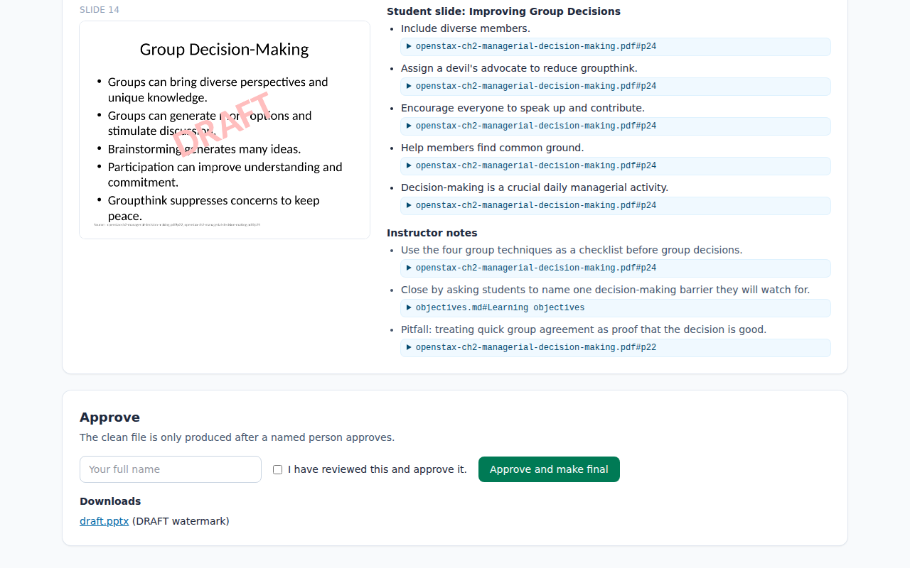
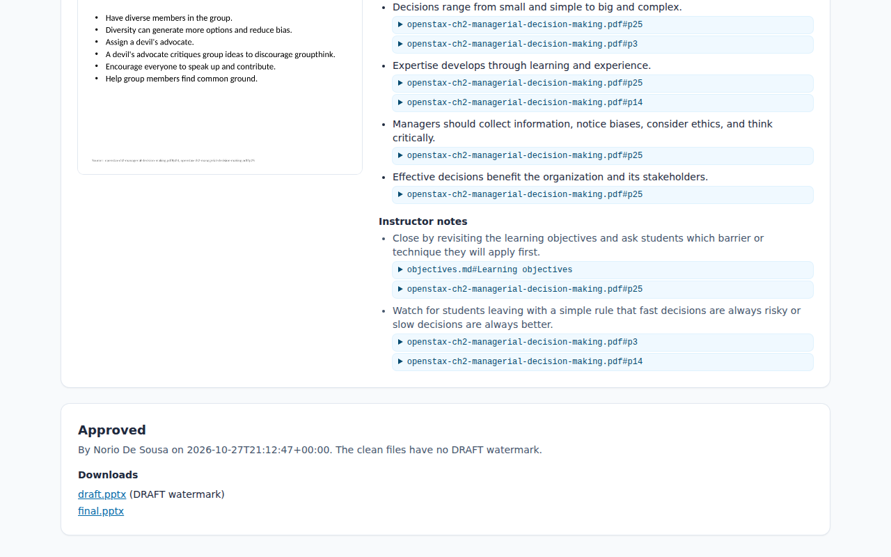
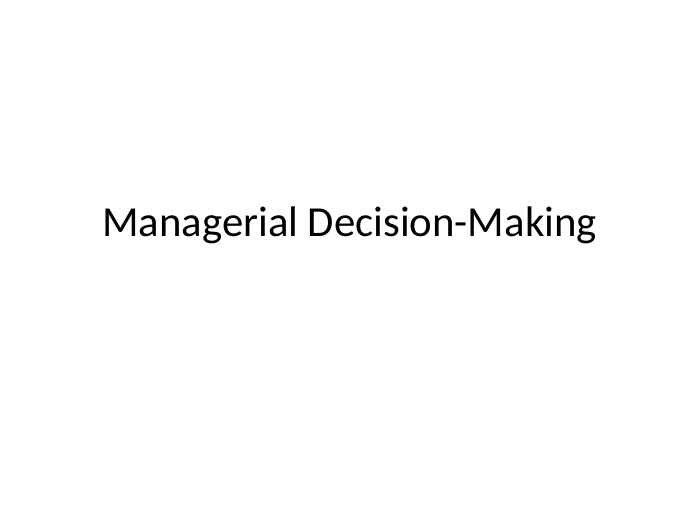
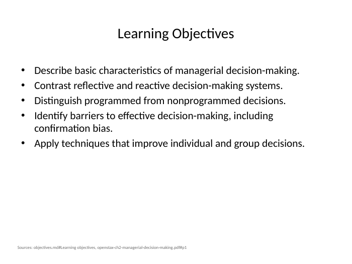
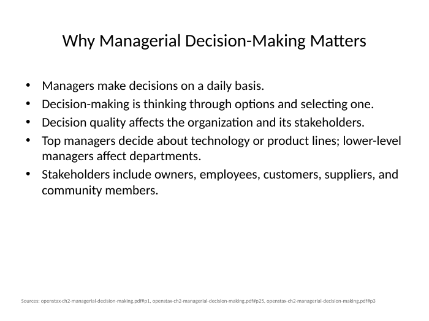
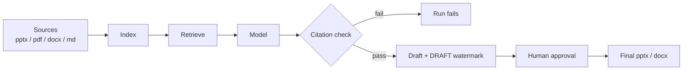

# sourcedraft

Turns your own source documents (slides, PDFs, Word files, notes) into editable Office drafts. Every claim points back to the page or slide it came from. Nothing is final until a named person approves it.

[Overview PDF](demo/sourcedraft-overview.pdf) · [Silent walkthrough video (2 min 45)](demo/walkthrough.mp4) · [Final deck as PDF](demo/demo-deck.pdf)



## See the results

**The web screen.** Add documents, ingest, pick what to make, review every point with its source, approve by name.






You do not need to install anything. These were produced from one chapter of an open textbook plus course objectives.

**Teaching deck** (student slides, instructor notes in the speaker notes, a source line on every slide):





Downloads:

- [Final teaching deck (.pptx)](demo/teaching-deck-FINAL.pptx)
- [Final case vignette for students (.docx)](demo/case-vignette-FINAL.docx)
- [Matching teaching note for the instructor (.docx)](demo/case-vignette-teaching-note-FINAL.docx)
- Before approval, the drafts carry a DRAFT watermark: [deck draft](demo/teaching-deck-DRAFT.pptx), [vignette draft](demo/case-vignette-DRAFT.docx)
- [The full record of one run](demo/run-teaching-deck/): what was retrieved, what the model returned, the check results, who approved and when.

## What it does

1. **Ingest**: reads your files and splits them into small pieces, each with an id like `chapter.pdf#p25`.
2. **Retrieve**: finds the pieces that match the topic.
3. **Draft**: the model writes only from those pieces and must name the id behind every bullet.
4. **Check**: any unknown id or uncited claim fails the run.
5. **Approve**: a person reviews, then approves by name. Only then is the clean final file produced.



## Privacy options

One line in `project.yaml` chooses where the text goes:

| Option | Setting | Data leaves your machine? |
|---|---|---|
| Local model (Ollama, vLLM) | `base_url: http://localhost:11434/v1`, `privacy: local-only` | No. Remote URLs are refused. |
| Private cloud tenant (Azure OpenAI and similar) | your tenant's `base_url` | Only to your own tenant |
| OpenRouter (used in the demo) | `https://openrouter.ai/api/v1` | Yes, to the chosen model provider |

## Swap any part

- **Different course, client or bid**: copy `projects/demo-management/` to a new folder, drop files in `sources/`, edit `project.yaml`. No code change.
- **Model or provider**: change `provider` in `project.yaml` (base_url, model, name of the env var holding the key).
- **New kind of output**: copy a folder in `recipes/`, edit `prompt.md` (instructions), `schema.json` (shape of the answer), `recipe.yaml` (exporter and search queries).
- **Your own look**: put your .pptx / .docx in `templates/` and name it in `project.yaml`.
- **Better search**: `sourcedraft/index.py` has one `search` function; swap it for embeddings.

## Quickstart

```bash
python3 -m venv .venv && . .venv/bin/activate && pip install -r requirements.txt
echo "OPENROUTER_API_KEY=your-key" > .env
python -m sourcedraft ingest demo-management
python -m sourcedraft draft demo-management teaching-deck --topic "Managerial decision making"
python -m sourcedraft review <run>
python -m sourcedraft approve <run> --by "Your Name"
```

The web screen (Laravel, in `ui/`) calls the same commands. Setup is in [ui/README.md](ui/README.md); it needs LibreOffice to draw the slide images.

`<run>` is printed by `draft`, e.g. `demo-management/20261027-210018-teaching-deck`. Outputs land in `runs/<project>/<run>/`. Other commands: `sd runs <project>`. Tests: `python -m pytest`.

## Attribution

Demo source text: *Principles of Management*, chapter 2, OpenStax, Rice University, [CC BY 4.0](https://creativecommons.org/licenses/by/4.0/), https://openstax.org/books/principles-management. The "publisher" slides in the demo are a stand-in generated from that chapter, and the objectives are written for the demo.
